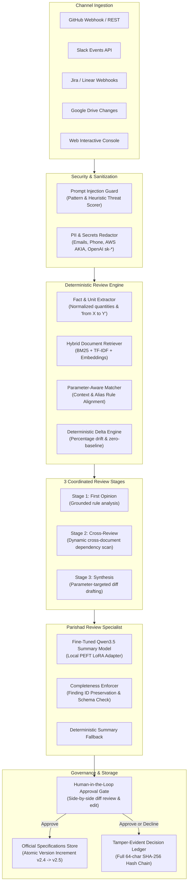

# Parishad / CortexOS — System Architecture & Technical Specifications
**Document Version:** 4.3.0  
**Target Environment:** Local Python 3.12 / FastAPI / SQLite (or PostgreSQL) / Google Colab SFT  
**Architecture Classification:** Autonomous Company Brain & Tamper-Evident Decision Governance System

---

## 1. System Overview

Parishad (CortexOS) is an enterprise governance and autonomous decision platform designed to maintain a single immutable source of truth for technical, hardware, and operational specifications.

In modern distributed engineering environments, specification drift is one of the highest causes of production incidents:
- Electrical teams change battery cut-off voltages without notifying firmware or thermal engineers.
- Automotive radar teams adjust CAN-FD baud rates, breaking harness EMC compliance.
- Customer support operations teams shorten refund windows, contradicting published legal terms.

Parishad resolves this by intercepting change proposals from developer channels (GitHub PRs, Slack conversations, Jira tickets, Google Drive changes, and direct manual console submissions) and subjecting them to a deterministic, multi-stage governance pipeline.

---

## 2. Core Subsystems

### 2.1 Untrusted Ingestion & Pre-Ingestion Security
All external text is treated as **untrusted data**.
1. **Prompt Injection Defense (`app/privacy/injection_guard.py`)**:
   - Analyzes text against 16+ adversarial jailbreak and system override signatures.
   - Calculates a normalized `threat_score` (0.0 to 1.0).
   - Any threat score $\ge 0.50$ halts execution immediately with status `blocked` and returns zero database side-effects.
2. **PII & Secrets Redaction (`app/privacy/pii_redactor.py`)**:
   - Strips sensitive tokens (emails, phone numbers, SSNs, credit cards, AWS `AKIA*` access keys, OpenAI `sk-*` API keys, IPv4 addresses).
   - Downstream models and search indexes only process cleaned, sanitized text spans.

### 2.2 Deterministic Python Review Engine
The Python engine is the sole authoritative decision-maker for physical calculations and rule violations.
- **Fact Extractor (`app/extraction/fact_extractor.py`)**:
  - Extracts numeric values and maps units into canonical representations (`V`, `Mbps`, `days`, `°C`, `%`, `USD`, `RPM`, etc.).
  - Resolves target proposals using directional context (`set to`, `increase to`, `from X to Y`), prioritizing units over bare unitless numbers.
- **Parameter-Aware Matcher (`app/agents/opinion_agent.py`)**:
  - Matches candidate facts against official document rules using parameter label aliases, keywords, and compatible physical units.
  - Strictly rejects fallback to unrelated rules; returns `INSUFFICIENT_EVIDENCE` when no parameter matches.
- **Deterministic Delta Engine**:
  - Nonzero baseline: $\Delta\% = \frac{|\text{proposed} - \text{official}|}{|\text{official}|} \times 100$.
  - Zero baseline: flags as special baseline-zero transition ($\Delta\% = 100\%$, severity critical), requiring explicit engineering authorization.

### 2.3 The 3 Coordinated Review Stages
1. **Stage 1 — First Opinion (`app/agents/opinion_agent.py`)**: Evaluates direct parameter drift and computes numeric severity (`critical`, `high`, `medium`, `low`).
2. **Stage 2 — Cross-Review (`app/agents/review_agent.py`)**: Dynamically scans other official specifications for cascading impacts and searches immutable decision history for past precedents.
3. **Stage 3 — Synthesis (`app/agents/synthesis_agent.py`)**: Generates an actionable verdict, reviewer checklist, and parameter-targeted proposed text changes without arbitrary number substitution.

### 2.4 Dedicated Parishad Review Specialist
- **Architecture**: `Qwen/Qwen3.5-4B` fine-tuned with Unsloth LoRA ($r=16, \alpha=32$).
- **Output Schema**: Pydantic v2 `ParishadReviewReport`.
- **Finding ID Invariance**: The backend `ReviewSummaryService` programmatically verifies that 100% of input finding IDs are preserved. If any ID is dropped or duplicated, the deterministic fallback immediately restores all findings with zero loss of engineering facts.

### 2.5 Tamper-Evident Cryptographic Ledger
- **Hashing**: Full 64-character SHA-256 hex digest (`sha256:HEX`).
- **Hash Chaining**: Each record $i$ computes:
  $$\text{Digest}_i = \text{SHA-256}(\text{CanonicalPayload}_i \parallel \text{Digest}_{i-1})$$
  Genesis entry chains to `0` $\times 64$.
- **Verification (`/api/v1/ledger/verify`)**: Recomputes all hashes from genesis to head and verifies chain continuity.

---

## 3. Technology Stack & Dependencies

- **Language Runtime**: Python 3.12+
- **API Framework**: FastAPI 0.115+, Uvicorn (ASGI)
- **Data Validation**: Pydantic v2.10+
- **Database ORM**: SQLAlchemy 2.0+ (asyncio), aiosqlite (local SQLite) / asyncpg (PostgreSQL)
- **HTTP Client**: HTTPX 0.28+
- **AI Integration**: Google Gemini API (`gemini-2.5-flash`, `gemini-embedding-001`)
- **Fine-Tuning Stack**: Unsloth, Hugging Face Transformers, PEFT, PyTorch
- **Frontend**: Single-Page Application (HTML5, Tailwind CDN, AlaSQL, Outfit & JetBrains Mono typography)
