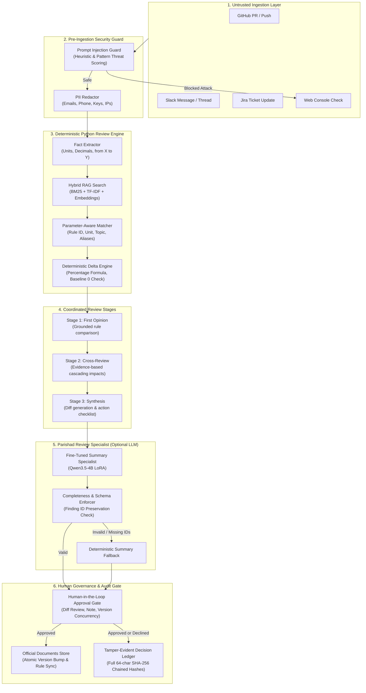

# Parishad — Implementation & Architecture Audit
**Document Version:** 4.3.0  
**Audit Date:** 2026-10-22  
**Auditor:** Senior Engineering Architecture Team  
**Scope:** Complete repository audit of `d:\parishad` (FastAPI backend, Council of Agents, Ingestion Connectors, Cryptographic Ledger, Company Brain RAG, Parishad Review Specialist, and Interactive Frontend).

---

## 1. Executive Summary

Parishad (Parishad) is an autonomous Company Brain and Decision Ledger engineered to prevent specification drift in high-consequence engineering, hardware, and operational environments (such as 48V Battery Management Systems, 77GHz Automotive Radar, and Customer SLA/Refund Policies).

The system intercepts incoming change proposals across communication and code channels (GitHub, Slack, Jira, Drive, manual console), subjects them to deterministic parameter extraction and rule conflict detection, validates cascading impacts through a 3-stage Council of Agents, routes conflicting proposals to a human-in-the-loop safety gate, atomically updates official specifications upon approval, and records an immutable cryptographic audit trail.

This audit establishes the exact boundaries between deterministic Python logic and generative AI, details existing vulnerabilities and design defects, and maps out the implementation roadmap.

---

## 2. Feature-by-Feature Status Audit

| Feature Module | Source File | Status | Implementation Details & Gaps |
| :--- | :--- | :--- | :--- |
| **FastAPI Entry Point** | `backend/app/main.py` | **Partly Defective** | **Defect:** Routers were registered inside `try...except ImportError` blocks, causing missing dependencies to silently disable entire API sections without failing fast. |
| **Privacy Redaction** | `backend/app/privacy/pii_redactor.py` | **Working** | Regex-based detection for emails, phone numbers, SSNs, credit cards, AWS `AKIA*` keys, OpenAI `sk-*` keys, and IPv4 addresses. Caveat: does not detect unstructured PII or obscure credentials. |
| **Injection Defense** | `backend/app/privacy/injection_guard.py` | **Working** | 16+ adversarial heuristics covering system prompt overrides, instruction resets, SQL injection fragments, and script injection. Threat score 0.0–1.0. |
| **Fact Extraction** | `backend/app/extraction/fact_extractor.py` | **Working / Needs Hardening** | Extracts numeric values with physical/financial units (V, Mbps, °C, %, USD, A, ms, etc.) and "from X to Y" patterns. **Gap:** Blindly selected the last extracted number as proposed value; ambiguous multi-parameter text needs resolution. |
| **Parameter-Aware Matcher** | `backend/app/agents/opinion_agent.py` | **Critical Defect** | **Defect:** Matched rules by unit alone and had an unsafe fallback: `if not matching_rule and doc_rules: matching_rule = doc_rules[0]`. Could compare voltage with temperature. Arbitrary denominator of 1.0 on zero baseline. |
| **3-Stage Review Council** | `backend/app/agents/` | **Needs Realism** | **Defect:** Stage 2 (Cross-Review) had hard-coded heuristics (`"voltage" in param -> thermal`, `"speed" -> CAN-FD`). Needs evidence-grounded dependency retrieval. Stage 3 needed parameter-aware diffs. |
| **Hybrid Document RAG** | `backend/app/rag/hybrid_search.py` | **Working** | Combines custom BM25, TF-IDF term overlap, and vector similarity with topic bonus. |
| **Embeddings** | `backend/app/rag/embeddings.py` | **Needs Update** | **Defect:** Referenced deprecated `text-embedding-004`. Must be updated to Google Gemini's stable `gemini-embedding-001` with deterministic subword hash-vector local fallback. |
| **Human Approval Workflow** | `backend/app/api/routes_approvals.py` | **Working / Needs Concurrency** | Lists pending drafts, allows editing proposed values, updates official doc, bumps version. **Gap:** Missing optimistic concurrency check against concurrent stale document mutations. |
| **Decision Ledger** | `backend/app/api/routes_ledger.py` | **Critical Defect** | **Defect:** SHA-256 hash was truncated to 12 hex characters (`[:12]`). Did not maintain a verifiable hash chain (`prev_hash`). Missing independent verification endpoint. |
| **SQL Explorer** | `backend/app/api/routes_system.py` | **Security Vulnerability** | **Defect:** Checked `query.upper().startswith("SELECT")` only. Permitted `UNION`, comments, nested queries, and lacked a strict table allowlist. |
| **Specification OCR** | `backend/app/api/routes_brain.py` | **Defect** | **Defect:** Returned a hardcoded mock BMS specification when vision API failed or was unconfigured, creating the illusion of successful OCR. |
| **Parishad Review Specialist** | `backend/app/specialist/` | **Fully Implemented** | Dedicated summary generation with 100% finding preservation (`ReviewCompleteness`), deterministic fallback, and LoRA PEFT loader. Safe behind `PARISHAD_LOCAL_SUMMARY_ENABLED`. |
| **Ingestion Connectors** | `backend/app/ingestion/` | **Working** | GitHub, Slack, Jira, Google Drive connectors with webhook signature validation and event normalization. |

---

## 3. Architecture & Data Flow

---

## 4. Separation of Responsibilities

### A. Deterministic Python Review Engine (Authoritative)
- **Fact Extraction:** Identifies numbers and standardized units.
- **Rule Matching:** Validates parameter context and selects exact rules.
- **Math:** Calculates `delta_pct = abs(proposed - official) / abs(official) * 100`. Special cases zero baselines.
- **Conflict Assessment:** Determines if drift exceeds configured rule tolerances.
- **Human Authority:** Controls approval endpoints and checks reviewer roles.
- **Database & Ledger:** Executes atomic database updates and cryptographic hash chaining.

### B. Optional Generative AI (Advisory)
- **Explanations:** Generates natural language summaries of technical findings.
- **Company Brain Q&A:** Grounded search across official documents with explicit citations.
- **OCR:** Reads specification datasheets when vision credentials are valid.
- **Bounds:** Must timeout gracefully (default 10s), catch exceptions, and fall back to local evidence displays.

### C. Parishad Review Specialist (Structured Reporting)
- **Role:** Formats pipeline findings into a strict JSON schema (`ParishadReviewReport`).
- **Restrictions:** Cannot change verdicts, drop finding IDs, create new rules, or touch the database.

---

## 5. Defect Analysis & Action Items

1. **Router Registration (`backend/app/main.py`)**:
   - *Problem:* `try...except ImportError` suppressed missing dependencies.
   - *Fix:* Import all required routers explicitly. Fail fast on dependency errors.
2. **Rule Matcher Fallback (`backend/app/agents/opinion_agent.py`)**:
   - *Problem:* `matching_rule = doc_rules[0]` caused cross-domain false matches.
   - *Fix:* Implement parameter name and alias matching. Return `INSUFFICIENT_EVIDENCE` when no parameter matches.
3. **Division by Zero (`backend/app/agents/opinion_agent.py`)**:
   - *Problem:* `abs(proposed - official) / (official if official != 0 else 1.0)`.
   - *Fix:* Explicit zero baseline handling.
4. **Hardcoded Stage 2 Cross-Review (`backend/app/agents/review_agent.py`)**:
   - *Problem:* Hardcoded strings for voltage/radar/refund.
   - *Fix:* Dynamic query of related documents and decision history with verification flags.
5. **Truncated SHA-256 Ledger Digest (`backend/app/api/routes_approvals.py`)**:
   - *Problem:* Digest truncated to 12 hex characters (`hexdigest()[:12]`).
   - *Fix:* Full 64-character SHA-256 hash. Add `prev_hash` chaining and independent verification endpoint `/api/v1/ledger/verify`.
6. **Insecure SQL Explorer (`backend/app/api/routes_system.py`)**:
   - *Problem:* `startswith("SELECT")` allowed SQL injections, UNIONs, and comments.
   - *Fix:* Restricted SQL validator enforcing table allowlist (`official_docs`, `doc_rules`, `pending_approvals`, `decision_ledger`), forbidding nested injection, comments, and multiple statements.
7. **Fake OCR Fallback (`backend/app/api/routes_brain.py`)**:
   - *Problem:* Returned hardcoded mock BMS specs on OCR failure.
   - *Fix:* Return explicit `OCR_UNAVAILABLE` or `OCR_FAILED`.
8. **Authentication & Authorization**:
   - *Problem:* No server-side role verification on approvals or admin routes.
   - *Fix:* Implement RBAC (`viewer`, `engineer`, `reviewer`, `admin`) with API key/Bearer token validation.
